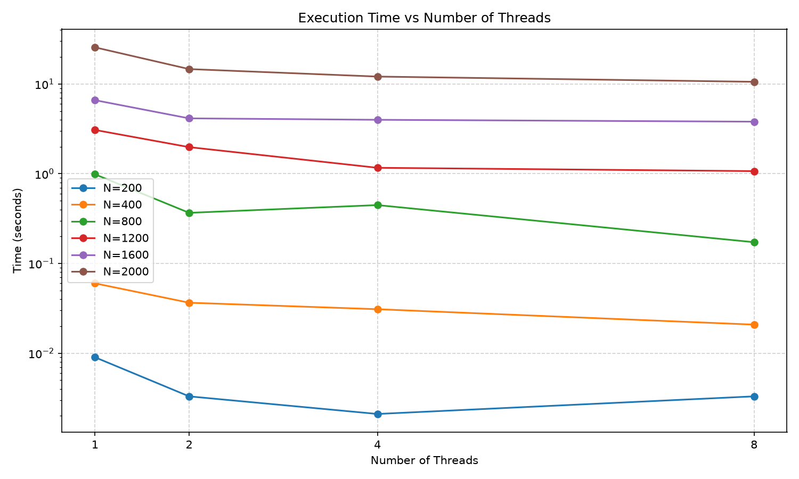
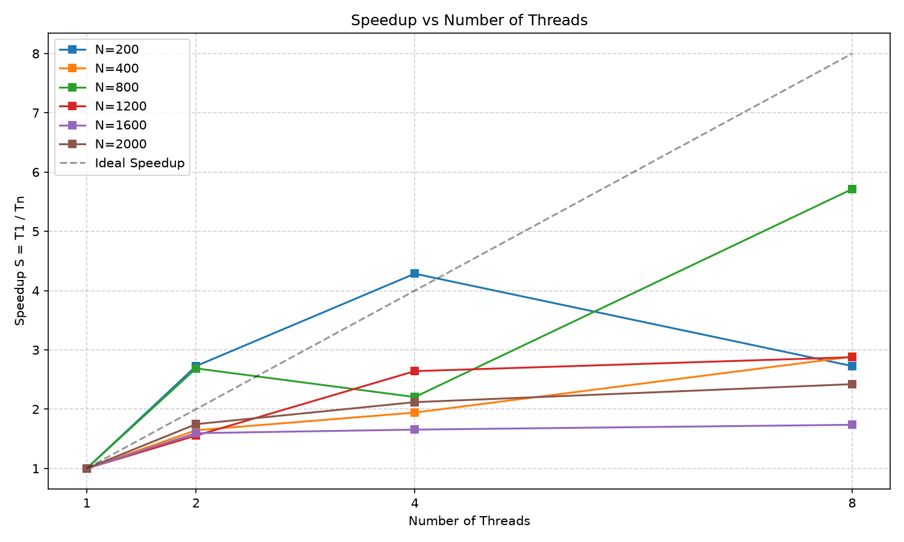

# Лабораторная работа №2: параллельная версия c OpenMP

## 1. Постановка задачи

**Цель работы:** модифицировать программу из лабораторной работы №1 для параллельной работы по технологии OpenMP и провести серию экспериментов с разным количеством потоков и разными размерами матриц.

## 2. Реализация

Внешний цикл распараллелен с помощью директивы OpenMP.

**Ключевой фрагмент кода:**
```cpp
#pragma omp parallel for
for (int i = 0; i < _size; ++i)
    for (int j = 0; j < _size; ++j) {
        int s = 0;
        for (int k = 0; k < _size; ++k)
            s += (*this)[i][k] * other[k][j];
        prod[i][j] = s;
    }
```

## 3. Верификация и результаты вычислений

Все вычисления прошли проверку на корректность при помощи скрипта verify.py

| Размер | Потоки | Время (сек) | Ускорение | Эффективность |
| :---: | :---: | :---: | :---: | :---: |
| 200 | 1 | 0.0090 | 1.00 | 1.00 |
| 200 | 2 | 0.0033 | 2.73 | 1.36 |
| 200 | 4 | 0.0021 | 4.29 | 1.07 |
| 200 | 8 | 0.0033 | 2.73 | 0.34 |
| 400 | 1 | 0.0600 | 1.00 | 1.00 |
| 400 | 2 | 0.0365 | 1.64 | 0.82 |
| 400 | 4 | 0.0309 | 1.94 | 0.49 |
| 400 | 8 | 0.0208 | 2.88 | 0.36 |
| 800 | 1 | 0.9855 | 1.00 | 1.00 |
| 800 | 2 | 0.3667 | 2.69 | 1.34 |
| 800 | 4 | 0.4471 | 2.20 | 0.55 |
| 800 | 8 | 0.1725 | 5.71 | 0.71 |
| 1200 | 1 | 3.0765 | 1.00 | 1.00 |
| 1200 | 2 | 1.9792 | 1.55 | 0.78 |
| 1200 | 4 | 1.1647 | 2.64 | 0.66 |
| 1200 | 8 | 1.0695 | 2.88 | 0.36 |
| 1600 | 1 | 6.6055 | 1.00 | 1.00 |
| 1600 | 2 | 4.1416 | 1.59 | 0.80 |
| 1600 | 4 | 3.9919 | 1.65 | 0.41 |
| 1600 | 8 | 3.8047 | 1.74 | 0.22 |
| 2000 | 1 | 25.6347 | 1.00 | 1.00 |
| 2000 | 2 | 14.6737 | 1.75 | 0.87 |
| 2000 | 4 | 12.1034 | 2.12 | 0.53 |
| 2000 | 8 | 10.5859 | 2.42 | 0.30 |

Ускорение вычисляется как S = T1 / Tn, где T1 — время на 1 потоке, Tn — время на N потоках.
Эффективность вычисляется как E = S / N.

## 4. Графики





## 5. Выводы

1. **Программа работает корректно** — верификация подтвердила полное совпадение результатов на всех количествах потоков.

2. **OpenMP даёт ускорение на больших матрицах** — на N=2000 время уменьшилось с 25.63 сек (1 поток) до 10.59 сек (8 потоков), ускорение 2.42. На N=1200 ускорение 2.88, на N=800 — 5.71.

3. **Наблюдается плато после 4 потоков.** Процессор Intel Core i5-13420H имеет 4 производительных (P-core) и 4 эффективных (E-core) ядра. При количестве потоков больше 4 часть работы выполняется на медленных E-ядрах, что снижает эффективность. На 8 потоках эффективность падает до 0.30.

4. **На маленьких матрицах (200×200, 400×400) ускорение нестабильно.** Время работы слишком мало (тысячные доли секунды), и накладные расходы на создание потоков сопоставимы с полезной работой. Например, для N=200 время на 8 потоках (0.0033 сек) даже больше, чем на 4 (0.0021 сек).
