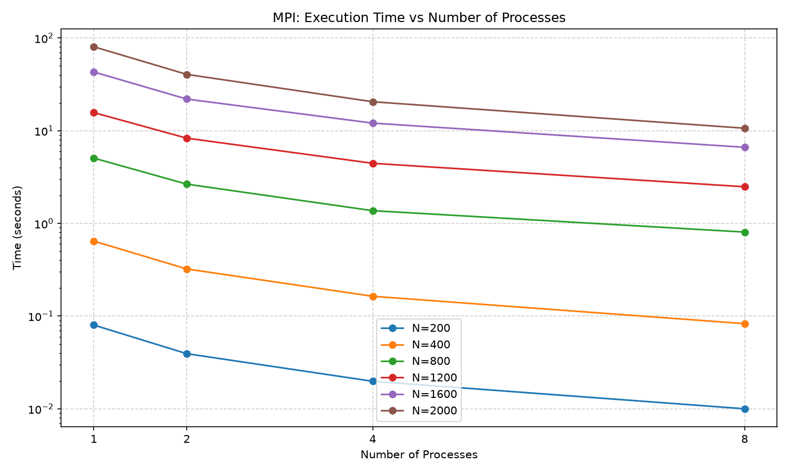
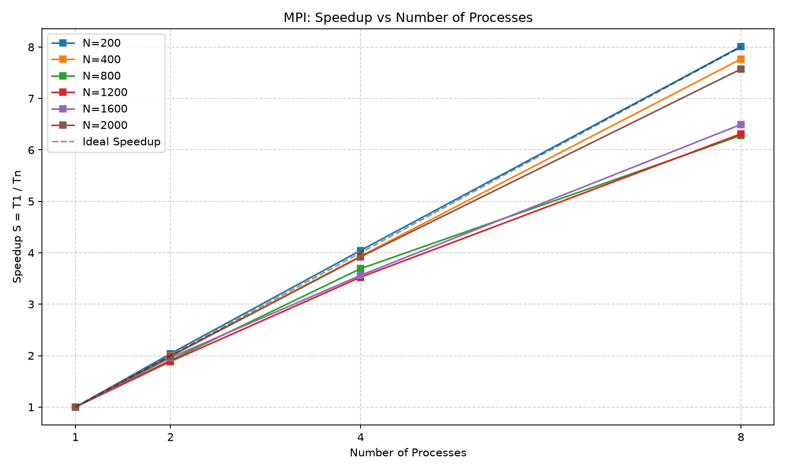

# Лабораторная работа №3: параллельная версия c MPI

## 1. Постановка задачи

**Цель работы:** модифицировать программу из лабораторной работы №1 для параллельной работы по технологии MPI и провести серию экспериментов с разным количеством процессов и разными размерами матриц на суперкомпьютере «Сергей Королёв».

## 2. Реализация

Внешний цикл распараллелен путём распределения строк матрицы A между процессами. Каждый процесс умножает свою часть A на полную матрицу B, после чего результаты собираются на главном процессе.

**Ключевой фрагмент кода:**
```cpp
MPI_Bcast(B.data(), N * N, MPI_INT, 0, MPI_COMM_WORLD);

MPI_Scatter(A.data(), rows_per_proc * N, MPI_INT, 
            local_A.data(), rows_per_proc * N, MPI_INT, 
            0, MPI_COMM_WORLD);

for (int i = 0; i < rows_per_proc; ++i)
    for (int j = 0; j < N; ++j) {
        long long sum = 0;
        for (int k = 0; k < N; ++k)
            sum += static_cast<long long>(local_A[i * N + k]) * B[k * N + j];
        local_C[i * N + j] = static_cast<int>(sum);
    }

MPI_Gather(local_C.data(), rows_per_proc * N, MPI_INT,
           C.data(), rows_per_proc * N, MPI_INT,
           0, MPI_COMM_WORLD);
```

## 3. Верификация и результаты вычислений

Все вычисления прошли проверку на корректность при помощи скрипта verify.py

| Размер | Процессы | Время (сек) | Ускорение | Эффективность |
| :---: | :---: | :---: | :---: | :---: |
| 200 | 1 | 0.0801 | 1.00 | 1.00 |
| 200 | 2 | 0.0393 | 2.04 | 1.02 |
| 200 | 4 | 0.0198 | 4.05 | 1.01 |
| 200 | 8 | 0.0100 | 8.01 | 1.00 |
| 400 | 1 | 0.6439 | 1.00 | 1.00 |
| 400 | 2 | 0.3226 | 2.00 | 1.00 |
| 400 | 4 | 0.1636 | 3.94 | 0.98 |
| 400 | 8 | 0.0829 | 7.77 | 0.97 |
| 800 | 1 | 5.0642 | 1.00 | 1.00 |
| 800 | 2 | 2.6524 | 1.91 | 0.95 |
| 800 | 4 | 1.3718 | 3.69 | 0.92 |
| 800 | 8 | 0.8064 | 6.28 | 0.79 |
| 1200 | 1 | 15.6883 | 1.00 | 1.00 |
| 1200 | 2 | 8.3098 | 1.89 | 0.94 |
| 1200 | 4 | 4.4495 | 3.53 | 0.88 |
| 1200 | 8 | 2.4850 | 6.31 | 0.79 |
| 1600 | 1 | 43.0240 | 1.00 | 1.00 |
| 1600 | 2 | 21.9539 | 1.96 | 0.98 |
| 1600 | 4 | 12.0779 | 3.56 | 0.89 |
| 1600 | 8 | 6.6248 | 6.49 | 0.81 |
| 2000 | 1 | 80.5211 | 1.00 | 1.00 |
| 2000 | 2 | 40.5285 | 1.99 | 0.99 |
| 2000 | 4 | 20.5357 | 3.92 | 0.98 |
| 2000 | 8 | 10.6346 | 7.57 | 0.95 |

Ускорение вычисляется как S = T1 / Tn, где T1 — время на 1 процессе, Tn — время на N процессах.
Эффективность вычисляется как E = S / N.

## 4. Графики





## 5. Выводы

1. **Программа работает корректно** — верификация подтвердила полное совпадение результатов на всех количествах процессов.

2. **MPI демонстрирует почти идеальное линейное ускорение.** На матрице 2000×2000 при использовании 8 процессов время выполнения сократилось с 80.5 секунд до 10.6 секунд, ускорение составило 7.57 раза, а эффективность — 95%. Для размеров 200 и 400 ускорение практически идеальное (близко к 8.0).

3. **Отсутствие плато, характерного для OpenMP.** В отличие от потоков OpenMP (которые конкурировали за 4 физических ядра), процессы MPI распределяются планировщиком Slurm по разным узлам/ядрам кластера, поэтому не мешают друг другу и масштабируются линейно.

